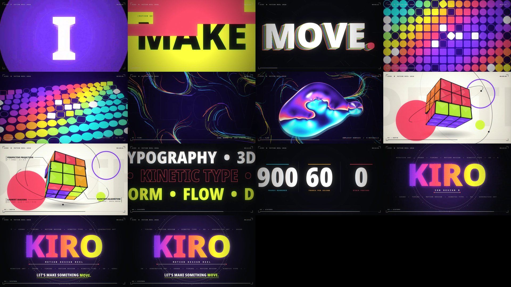

# KIRO — Motion Reel 2026

A 15-second, 1920×1080, 60 fps motion-graphics showreel. Every frame and every sound is generated by code.
No stock footage, no editing software, no ffmpeg.



## Watch

- `video/kiro-motion-reel-2026.webm` — full quality (VP9 + Opus, 23 MB)
- `video/kiro-motion-reel-2026-lite.webm` — lighter copy (11 MB)

## What's in it

| Beats | Scene | Techniques |
|---|---|---|
| 0–6 | I / MAKE / THINGS / MOVE. | kinetic type, per-letter springs, motion trails, glitch slices |
| 6–12 | Form | 144-shape grid, 3D tilt, phyllotaxis spiral |
| 12–18 | Flow | curl-noise streamlines, liquid-chrome metaballs |
| 18–24 | Depth | hand-rolled 3D engine, 27-cubelet twist cube |
| 24–32 | Systems | marquee, counters, particle logo, lockup |

128 BPM, 32 beats = exactly 15 s. Picture and score share one beat clock.

## How it works

- `src/core.js` — easing, noise, 3D maths, bloom / chromatic aberration / grain, HUD, timeline. `renderFrame(t)` is a pure function of time.
- `src/s1.js … s5.js` — the five scenes.
- `src/audio.js` — procedural score and sound design (WebAudio `OfflineAudioContext`).
- `src/mux.js` — minimal WebM muxer. `src/main.js` — WebCodecs VP9 + Opus encode.
- `build.cjs` — headless-Chrome driver. `verify.cjs` — decodes the output and checks it.

```bash
node build.cjs sheet out/sheet.png 0.4 3 0.05 0.5 1.0      # contact sheet of frames (seconds)
node build.cjs audio                                        # render + analyse the audio
node build.cjs render out/reel.webm 1                       # full 1080p render (~80 s)
node build.cjs render out/reel-lite.webm 1 4e6              # lower bitrate
```

`build.cjs` expects `playwright-core` and a Chromium headless shell at the paths near the top of the file. Edit them for your machine.

## Fonts

`src/fonts/` contains Noto Sans (Black, Condensed Black) and Source Code Pro (Bold), both under the SIL Open Font License.
